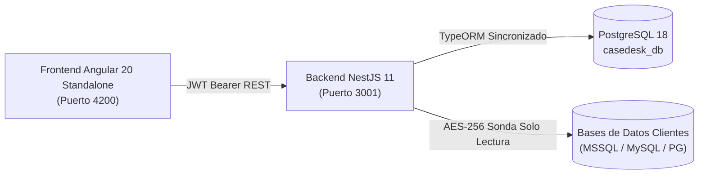

# Contexto del Proyecto y Estado Actual de Implementación

## 1. Visión General del Proyecto CaseDesk

**CaseDesk** nace de la necesidad de centralizar, estandarizar y automatizar el ciclo de vida completo de atención de casos e incidentes técnicos en software empresarial (Contabilidad, Inventario, Facturación Electrónica y Seguridad).

### 1.1. Problema que Resuelve
Anteriormente, el equipo técnico gestionaba los casos de forma fragmentada en carpetas locales en disco (`D:\casosBack\00068`, `00130`, `00187`, `00226`, `18253`, etc.), chats de mensajería y notas aisladas. Esto ocasionaba:
* **Pérdida de trazabilidad y conocimiento:** Soluciones a problemas contables o de base de datos recurrentes quedaban aisladas en carpetas personales.
* **Riesgo en seguridad y credenciales:** Las cadenas de conexión y accesos a bases de datos de clientes no contaban con un almacén centralizado ni cifrado seguro.
* **Fricción en la comunicación:** La explicación técnica profunda (causa raíz, consultas SQL, tablas involucradas) se mezclaba con la respuesta ejecutiva que debía recibir el cliente o la mesa de ayuda.
* **Ausencia de automatización:** Cada caso requería revisión manual de archivos de texto (`data.txt`), inspección visual de capturas de pantalla, redacción manual de consultas SQL diagnósticas y scripts de solución.

---

## 2. Arquitectura Tecnológica Implementada

La plataforma cuenta con un stack moderno, modular y tipado de extremo a extremo en **TypeScript**:

* **Backend:** **NestJS 11** con TypeORM, validación estricta con `class-validator`, seguridad con `passport-jwt` y documentación interactiva automática con **Swagger OpenAPI**.
* **Base de Datos Propia:** **PostgreSQL 18** (`casedesk_db`) con 14 tablas relacionales normalizadas.
* **Cifrado de Seguridad:** Algoritmo **AES-256-GCM** para almacenar de forma inviolable las credenciales de bases de datos remotas de clientes.
* **Frontend:** **Angular 20 Standalone** con componentes reactivos, gestión de estado con **Angular Signals Store**, iconos con **Lucide Angular** y estilos con **Tailwind CSS**.

---

## 3. Lo Que Se Ha Hecho (Estado Actual Completado)

### 3.1. Backend NestJS (`/backend`)
* [x] **Módulo de Autenticación y RBAC (`/api/auth`):**
  * Login con validación `bcrypt` y emisión de tokens JWT (7 días).
  * Decoradores de roles y guards para control de acceso basado en roles (`Admin`, `Desarrollador`, `Soporte`, `Cliente`).
* [x] **Módulo de Clientes y Conexiones (`/api/clients`, `/api/connections`):**
  * Directorio de clientes con NIT, contactos y recuento de casos.
  * Almacén de conexiones de bases de datos (SQL Server, PostgreSQL, MySQL) cifradas con AES-256-GCM.
  * Sonda de conectividad en modo solo lectura (`POST /api/connections/:id/test`) con medición de latencia en milisegundos.
* [x] **Módulo de Casos (`/api/cases`):**
  * Generación automática de código correlativo único (`CASO-00001`).
  * Máquina de estados: `Abierto`, `En Análisis`, `En Desarrollo`, `En Pruebas`, `Resuelto`, `Cerrado`.
  * Niveles de prioridad y SLA: `Baja`, `Media`, `Alta`, `Crítica`.
  * Indicadores de resumen y KPIs para el Dashboard (`/api/cases/metrics/summary`).
* [x] **Separación Estricta de Inteligencia Técnica vs. Comunicación:**
  * **Análisis Técnico Privado (`/api/cases/:id/analysis`):** Causa raíz, consultas SQL de diagnóstico, objetos de base de datos afectados (vistas, SPs, triggers).
  * **Solución Técnica y Reversión (`/api/cases/:id/solution`):** Script SQL de aplicación con transacciones seguras y script simétrico de rollback.
  * **Respuesta al Cliente (`/api/cases/:id/client-response`):** Redacción en lenguaje claro y ejecutivo, con estados de borrador y publicación oficial.
* [x] **Línea de Tiempo y Auditoría (`/api/cases/:id/timeline`):**
  * Registro cronológico automático de cambios de estado, notas internas y comentarios.
* [x] **Seeds de Datos y Casos Reales Precargados en PostgreSQL:**
  * `CASO-00226` — Mutual Ser EPS (Descuadre en Circular 016 vs. Anexo de Balance).
  * `CASO-00130` — SOMEDYT S.A.S. (Descuadre de -$3.287M en saldos iniciales 2025 por comprobantes anulados).
  * `CASO-18253` — Hospital Regional (Bloqueo en anulación de entradas por redondeo de centavos en costo unitario).

### 3.2. Frontend Angular (`/frontend`)
* [x] **Layout Principal y Shell:**
  * Barra lateral de navegación con métricas vivas y estado de conexiones.
  * Barra superior con **Workspace Multicaso Reactivo** usando Angular Signals Store: permite tener múltiples casos abiertos en pestañas simultáneas y alternar entre ellos al instante sin recarga ni pérdida de datos.
* [x] **Dashboard de Casos:**
  * Tarjetas KPI (Total casos, en análisis, en desarrollo, críticos, resueltos).
  * Tabla con filtrado por texto, estado, prioridad y cliente.
* [x] **Modal "+ Nuevo Caso":**
  * Formulario reactivo para radicar nuevos incidentes, seleccionando cliente, sistema, módulo y prioridad.
* [x] **Detalle del Caso en Pestaña Dedicada:**
  * Secciones independientes para Información General, Conexión BD (con botón interactivo de prueba de sonda), Análisis Técnico, Solución/Rollback, Respuesta al Cliente y Línea de Tiempo.
  * Notificaciones flotantes (toasts) reactivas de guardado y confirmación.
