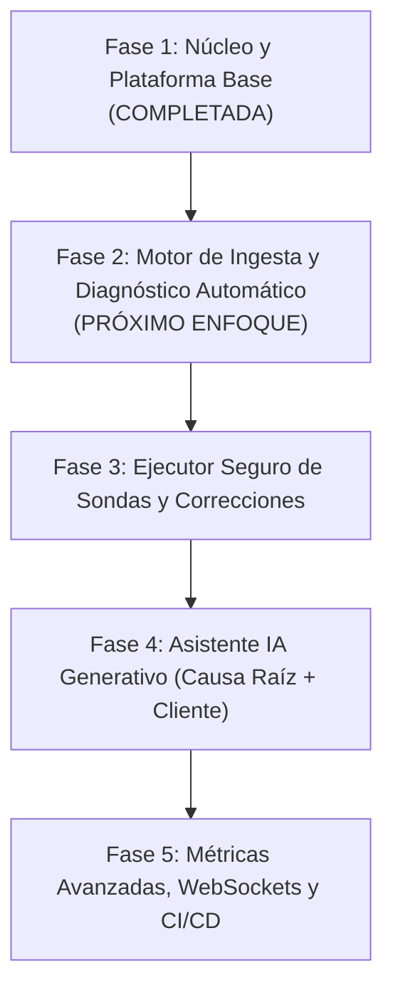

# Roadmap y Tareas Pendientes para Automatización de Casos

Este documento establece la hoja de ruta técnica para llevar a **CaseDesk** desde su estado actual (plataforma funcional de gestión y análisis) hacia el **sistema automatizado inteligente de diagnóstico y resolución de incidentes**.

---

## 1. Fases Pendientes y Objetivos Estratégicos

---

## 2. Detalle de Módulos y Tareas por Implementar

### Fase 2: Ingesta Automática de Casos e Integración de Archivos Locales
* [ ] **Lector / Ingestor Automático de Carpetas (`D:\casosBack`):**
  * Servicio en backend capaz de escanear o recibir carpetas estructuradas de casos (ej. `00068`, `00187`, `00226`).
  * Parseo automático del archivo `data.txt` para extraer la descripción inicial del problema.
  * Indexación y almacenamiento seguro en `/storage/attachments` de los adjuntos (`.png`, `.jpg`, `.xlsx`, `.pdf`).
* [ ] **Procesamiento de Evidencias Visuales (OCR / Visión):**
  * Extracción de texto y números de documento desde capturas de pantalla de formularios (por ejemplo, número de comprobante, cuenta contable, NIT, mensaje de error en pantalla).

---

### Fase 3: Motor de Autodiagnóstico y Sondas Remotas en Solo Lectura
* [ ] **Catálogo de Patrones de Falla Recurrentes:**
  * Motor de reglas para identificar causas raíz típicas:
    1. **Contabilidad:** Causaciones huérfanas en comprobantes anulados (`cabecera.anulado = 1` y `causacion.anulado = NULL`).
    2. **Contabilidad:** Cuentas sin atributo de cartera configurado (`atributos <> 2` o `<> 3`).
    3. **Contabilidad:** Desfase de códigos de ciudad en vistas (`ROW_NUMBER()` vs. tablas de seguridad).
    4. **Inventario:** Redondeo o truncamiento de decimales en costo unitario durante la anulación de entradas.
    5. **Cierre Anual:** Inyección directa en `saldo_general_acumulado` sin comprobante y falta de reclasificación de la cuenta 36 a la 37.
* [ ] **Ejecución Segura de Consultas Diagnósticas (`SELECT` en Sandbox):**
  * Endpoint en backend que, utilizando la conexión cifrada del cliente, ejecute exclusivamente consultas de solo lectura (`SELECT`) con timeout estricto (ej. 5 segundos) y límite de filas (`TOP 100`).
  * Visualización de resultados de la consulta directamente en tablas dinámicas dentro de la pestaña del caso en Angular.

---

### Fase 4: Generador Asistido de Soluciones, Rollbacks y Respuestas al Cliente
* [ ] **Generador de Scripts de Corrección con Transacciones Seguras:**
  * Generación automática de plantillas SQL estándar con bloque `BEGIN TRAN ... TRY ... COMMIT ... ROLLBACK`.
  * Generación automática del script inverso de reversión (Rollback).
* [ ] **Redactor Asistido de Respuestas al Cliente:**
  * Plantillas y motor asistido para convertir el diagnóstico técnico en dos formatos con un solo clic:
    * **Explicación Técnica:** Para el equipo de desarrollo y soporte nivel 3.
    * **Respuesta al Cliente / Mesa de Ayuda:** En lenguaje no técnico, cortés, claro y con las instrucciones operativas necesarias.

---

### Fase 5: Experiencia de Usuario y Productividad en Frontend
* [ ] **Editor Monaco Embebido en Angular:**
  * Integrar `monaco-editor` para edición y resaltado de sintaxis SQL y Markdown dentro de las secciones de "Análisis Técnico" y "Solución".
* [ ] **Visor de Imágenes y Comparador de Scripts (Diff Viewer):**
  * Zoom, lupa y visualización lado a lado de capturas de pantalla de evidencia.
  * Comparador de código para scripts antes/después.
* [ ] **Notificaciones en Tiempo Real (WebSockets / SSE):**
  * Avisos automáticos a los usuarios cuando un caso cambie de estado o sea asignado.
* [ ] **Filtros Avanzados y Exportación:**
  * Exportación de informes de casos resueltos en PDF y Excel para auditoría.

---

### Fase 6: Infraestructura y Despliegue
* [ ] **Dockerización Completa:**
  * `Dockerfile` para el backend NestJS (multi-stage build).
  * `Dockerfile` con Nginx para servir la SPA Angular compilada.
  * `docker-compose.yml` para levantar PostgreSQL 18 + Backend + Frontend con un único comando.
* [ ] **Pipeline de CI/CD:**
  * Configuración de GitHub Actions para ejecución automática de pruebas unitarias y e2e en cada push a la rama `main`.
